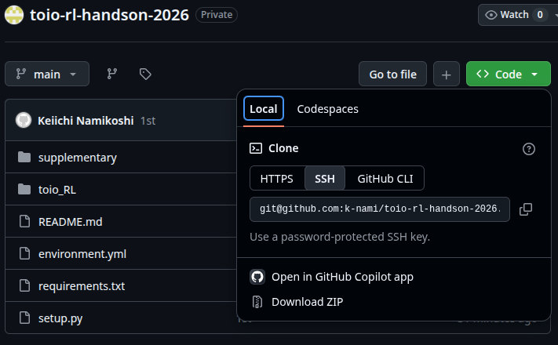
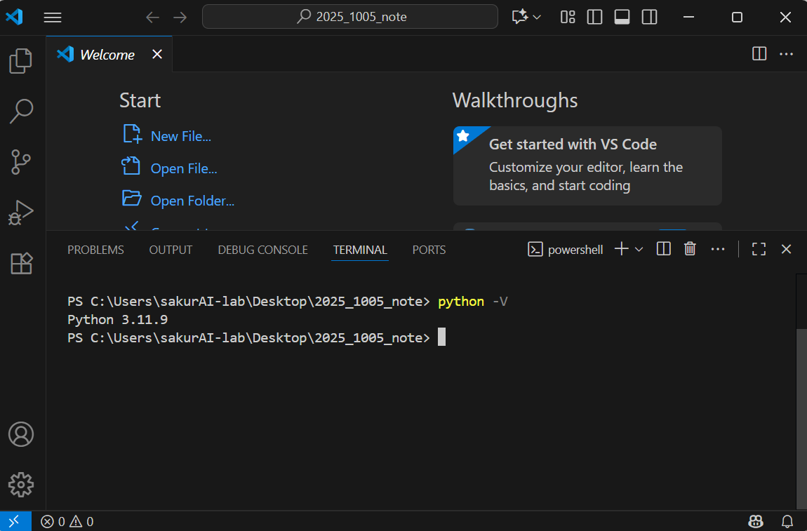
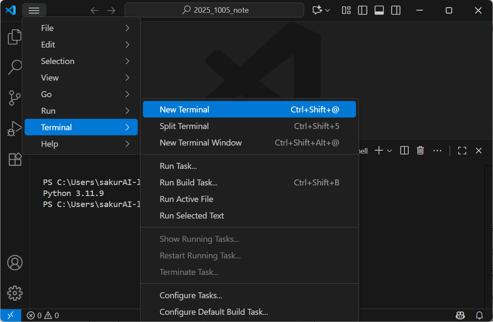
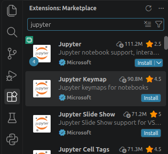
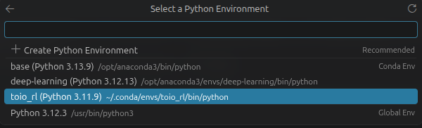

# toio-rl-handson

強化学習による移動ロボット制御（知能プログラミング演習Ⅱ）向けのPythonコードです．

## 使い方

コードは穴開き状態になっているため，そのままでは動きません．
（#TODO）の部分をご自身で書いてください．

## 準備

CSE環境は下記に従い環境構築して下さい．
もし，CSE環境以外を使用したい場合，[環境構築](supplementary/2025_build_env_note.md)を参考にしてください．
<!-- - 仮想環境で必要なパッケージをダウンロードしてください． -->

<!-- TODO: 画像をCSE環境に差し替え -->
### 1. 演習コードの準備

- GitHubのページへアクセスしてダウンロード
  - Code（緑ボタン）→「Download ZIP」
  - 

- ダウンロードされたzipファイルを展開（右クリック->展開/展開先）して，使いやすいディレクトリへ移動

- VSCodeで開く
  - VSCodeを立ち上げる→左上「File」の「Open Folder...」で，展開したフォルダを選択

- VSCodeで開いた状態
  - 

- terminalが開かれていない場合は，「Terminal」→「New Terminal」
  - 

### 2. 仮想環境の作成

数分かかります．

```bash
# インストール済みか確認．バージョンが表示されればOK．
conda -V

# 環境を作成（通信環境によっては，5分以上かかります）
conda env create -f environment.yml

# doneと表示されたのち、下記コマンドで「toio_rl」があればOK
conda env list
# conda environments:
#
toio_rl               *  /home/staff/<User>/.conda/envs/toio_rl
base                     /usr/local/anaconda3
python311                /usr/local/anaconda3/envs/python311

# 環境に入る
conda activate toio_rl

# 環境から出る
conda deactivate
```

## 実行方法

* 実行前に仮想環境環境を有効化してください
* 演習番号に対応したフォルダに移動してコードを実行します（例えば演習1ならp1）

```bash
cd toio_RL/p1_toio
python connect_toio.py
```

## 補足資料

- [パッケージの使用例](supplementary/cheetsheet.md)
- [デバッグ向けTips](supplementary/debugtips.md)

## VSCode extention

* Jupyter notebookを使用して結果を解析する場合は，jpyterのextentionを推奨



* 起動時にPython環境を尋ねられるので，「Select Another Kernel」→「toio_rl」を選択



## トラブルシューティング

### toioに繋がらない

いくつかの可能性が考えられます

- toioの電源が入っていない
- PCのBluetoothがoffになっている
- toioのIDを打ち間違えている
- コードが間違っている

